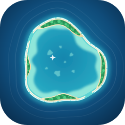

# Atoll

Atoll adds file-level redundancy to heterogeneous disks (SATA, USB DAS) that hold a media library (Plex, Emby, Jellyfin), without moving existing files.

**Under development and not ready for real data.** The alpha, phase 1a, is in progress: see [ROADMAP.md](ROADMAP.md).

## How it works

- **Copies.** Each file under a disk's `media/` folder can have 0 to 2 full copies on other disks, at the same relative path and under the same name. Every disk stays a normal folder tree, readable on its own.
- **The merged view.** A merged view presents each file once: mergerfs in phase 1, Atoll's own FUSE view from phase 2a. Media servers read that view.
- **Break glass.** Stopping or uninstalling Atoll breaks nothing. Existing paths stay as they were, no disk holds a hidden file, and plain mergerfs, mounted from the line `atoll mergerfs-config` prints, gives the same view.
- **No data lost.** Atoll never deletes or overwrites the last verified copy of a file. What it replaces goes to a trash on the same disk first. When in doubt, it keeps both versions and reports a conflict.
- **Checked.** Every copy is verified by a BLAKE3 hash before it takes its place.
- **Disks.** A disk is known by its filesystem's identifier. Atoll writes to it only once it has confirmed that identifier.
- **The catalog.** The SQLite catalog is a cache that can be rebuilt: the truth is on the disks.

The Go version runs on Linux, amd64 and arm64. A Rust rewrite with the same contracts follows, then Windows.

## Documentation

| File | What it holds |
|---|---|
| [specs.md](specs.md) | The specification, and the source of truth |
| [ROADMAP.md](ROADMAP.md) | The milestones, where the work stands, and what remains before each |
| [TODO.md](TODO.md), [DONE.md](DONE.md) | Open work, and finished work with how it was verified |
| [LESSONS.md](LESSONS.md) | What the work taught |
| [docs/research/](docs/research/) | The measurements behind open design decisions |
| [conformance/](conformance/README.md) | Vectors and scenarios shared by the Go and Rust versions |
| [api/](api/README.md) | The `--json` schemas of the command line |
| [deploy/](deploy/) | A sample configuration |

## Building and testing

Go 1.27 or later:

```bash
make build              # bin/atoll
go test ./...           # unit and property tests, with the conformance vectors
make conformance        # the black-box scenarios against a conformance build
make test-qemu          # test/loopdev as root in qemu, on Linux 6.12 and 7.3, with only Docker on the host
test/ci/run.sh [REV]    # every check of a commit, with only git and Docker
```

## License

SPDX-License-Identifier: GPL-3.0-or-later

The full text of version 3 is in [LICENSE](LICENSE).
