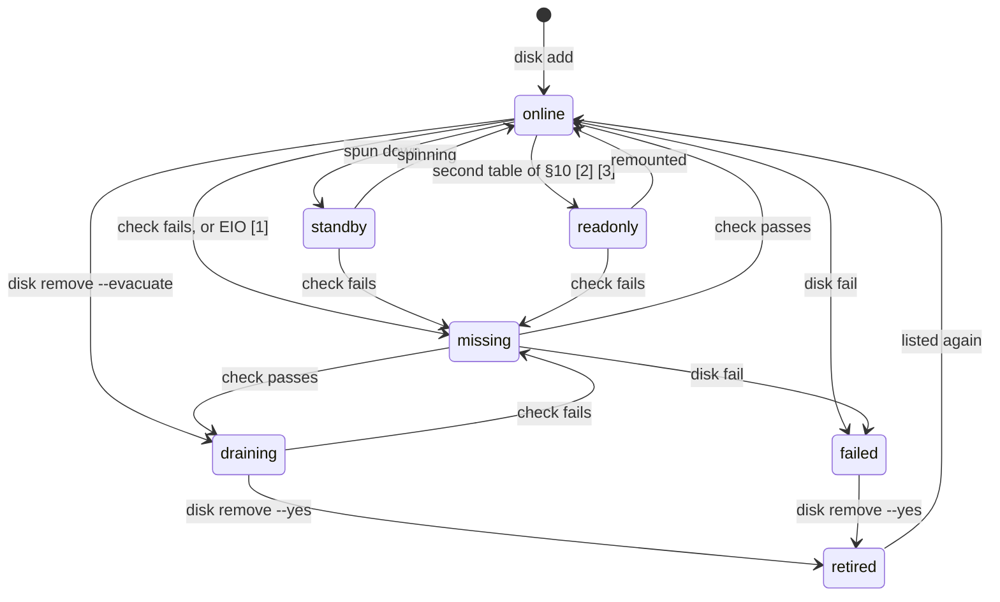
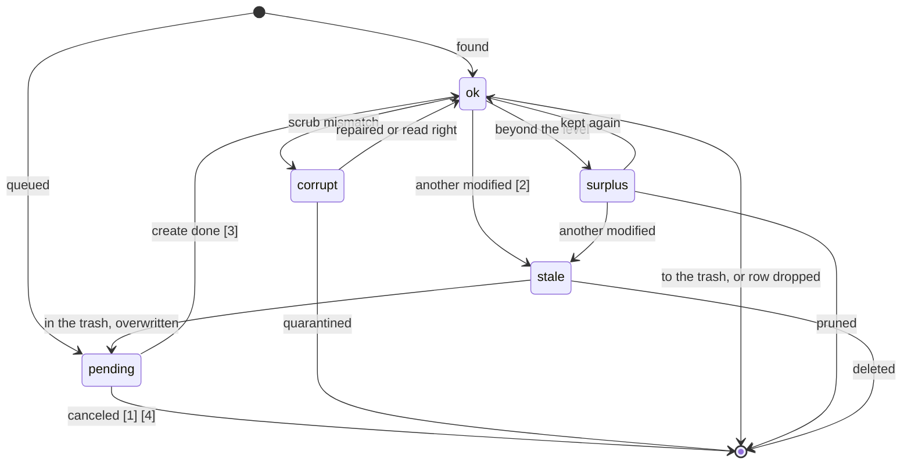

# Disk and copy states

Drawn from `states.json` by `go test ./conformance/models -run TestStatesDrawing -update`; edit that file, not this one. The states of a disk and of a copy, and what moves one to another, as specs.md says. states_test.go keeps them equal to the closed lists of schema/migrations and of specs.md §4, each transition to a state, and each bug to an entry of DONE.md that fixed it, or to a flaw of README.md still open.

## Disk states

| From | To | When | specs.md |
|---|---|---|---|
| (none) | `online` | `disk add`, the identity, topology and mount point checked | §10, §18 |
| `online` | `standby` | the daemon's check finds a whole disk in standby, waking none | §10 |
| `standby` | `online` | its counters moved, it has requests under way, or it answers spinning | §10 |
| `online` | `missing` | a mount check fails, or an I/O error on a disk that then does not confirm (invariant 4) | §10, §16, §17.1 |
| `standby` | `missing` | a mount check fails | §10 |
| `missing` | `online` | a mount check passes again; reconciliation first | §10, §18 |
| `online` | `readonly` | ro, ads, nocase, iocharset, errors-continue, casefold, ascii-ci, no-journal, ignore-case or other-marker | §10 |
| `readonly` | `online` | mounted again without what made it readonly | §10 |
| `readonly` | `missing` | a mount check fails | §10 |
| `online` | `draining` | `disk remove --evacuate` or `disk replace` set its state to draining | §18 |
| `draining` | `missing` | a mount check fails; draining again once it passes | §9, §18 |
| `missing` | `draining` | a mount check passes, its state still draining | §9, §18 |
| `draining` | `retired` | out of the configuration once nothing depends on it | §9, §18 |
| `online` | `failed` | `disk fail`: failed even if it comes back | §18 |
| `missing` | `failed` | `disk fail` | §18 |
| `failed` | `retired` | out of the configuration | §9, §18 |
| `retired` | `online` | the configuration lists it again | §9 |

| Bug | Transition | What went wrong | Where |
|---|---|---|---|
| [1] | `online` → `missing` | a sector the scrub could not read took its disk out at each slice, the copy never named | DONE.md, The review's sixteen decisions, made by the maintainer on 2026-11-13 |
| [2] | `online` → `readonly` | a disk another pool's marker named was written to | DONE.md, The maintainer's answers on the alpha, 2026-11-14 |
| [3] | `online` → `readonly` | an ext4 without a journal was written to | DONE.md, Two more decisions of the maintainer, made on 2026-11-14 |

## Copy states

| From | To | When | specs.md |
|---|---|---|---|
| (none) | `ok` | a walk finds a copy new to the catalog: a user's, never verified | §15.10 |
| (none) | `pending` | the plan queues a replicate job and its pending copy | §13.4, §14.1 |
| `pending` | `ok` | the operation create committed, or finished by a reprise | §14.2, §17.2 |
| `pending` | (none) | no longer kept or counted by the plan, or its job ended | §13.4, §14.1 |
| `ok` | `surplus` | more copies count than the level, and this one is not kept | §13.4 |
| `surplus` | `ok` | kept toward the level again | §13.4 |
| `ok` | `stale` | a modification of another copy, or a change of metadata it could not be given | §15.4 |
| `surplus` | `stale` | a modification of another copy | §15.4 |
| `stale` | `pending` | its trash job done: the row stays, a pending copy with its replicate job | §15.4, §15.12 |
| `ok` | `corrupt` | a chunk that does not match, read again past the cache, size and times unchanged | §16 |
| `corrupt` | `ok` | a chunk repair, or a copy that reads right after all | §16.1 |
| `corrupt` | (none) | to the trash, quarantined or repaired whole | §16, §16.1 |
| `ok` | (none) | deleted or renamed to the trash, or its row dropped by a decision Kept or Gone | §15.12, §17.1 |
| `surplus` | (none) | `prune` or `balance` send it to the trash | §13.3, §17.3 |
| `stale` | (none) | its file deleted, or its row dropped | §15.12 |

No transition enters:

- `unavailable`: in the closed list, kept as every value of version 1 is (§29.3), and read by the plan, the view and the alerts; but no transition of specs.md sets it, and no code writes it.

| Bug | Transition | What went wrong | Where |
|---|---|---|---|
| [1] | `pending` → (none) | a pending copy kept past min_free was written into the reserve | DONE.md, The review's sixteen decisions, made by the maintainer on 2026-11-13 |
| [2] | `ok` → `stale` | a copy no user changed went over the others | DONE.md, Two more decisions of the maintainer, made on 2026-11-14 |
| [3] | `pending` → `ok` | open, flaw 1: a write before the commit recorded as verified | README.md, Flaw 1, open |
| [4] | `pending` → (none) | open, flaw 2: a job running canceled with its pending copy | README.md, Flaw 2, open |
